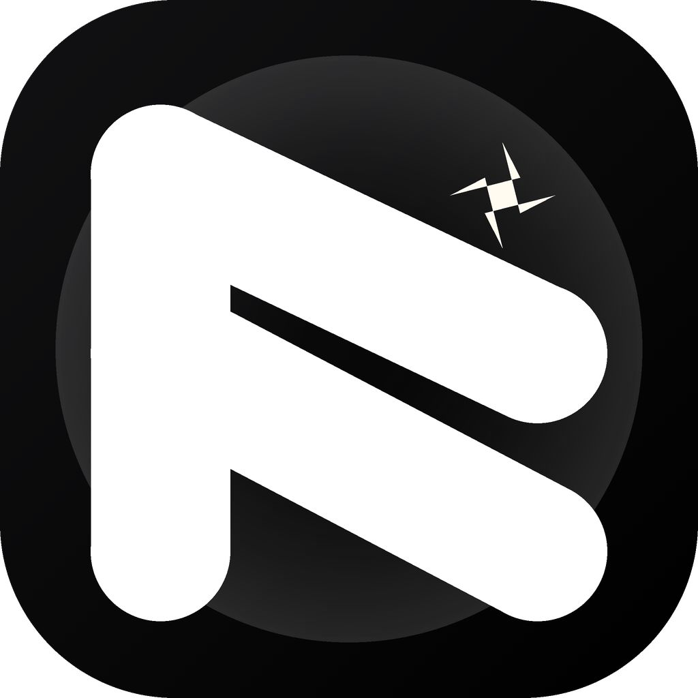

<div align="center">
  

  <h1>Keramika</h1>

  <p><strong>Будильник, который не даёт уснуть обратно.</strong><br />
  Задачи, привычки, питание и ИИ-ассистент Ада — в одном приложении.</p>

  <p>
    <a href="https://github.com/wxstdo-boop/Keramika/releases/latest"></a>
    <a href="LICENSE"></a>
    
    
    
    
  </p>
</div>

---

## 📸 Скриншоты

> [!NOTE]
> Галерея ещё не наполнена — в репозитории лежат только отладочные снимки с
> тестовыми данными. Нормальные скриншоты нужно снять с устройства и положить в
> [`docs/screenshots/`](docs/screenshots/). Как это сделать — там же README.

<div align="center">
  <table>
    <tr>
      <td width="33%"></td>
      <td width="33%"></td>
      <td width="33%"></td>
    </tr>
    <tr>
      <td align="center"><sub>Будильники</sub></td>
      <td align="center"><sub>Привычки</sub></td>
      <td align="center"><sub>Ада</sub></td>
    </tr>
  </table>
</div>

---

## ✨ Что умеет

### ⏰ Будильники
- Точное срабатывание: `SCHEDULE_EXACT_ALARM` + `USE_EXACT_ALARM`, foreground-сервис
  держит процесс живым, `WAKE_LOCK` будит CPU
- **Wake-task** — к каждому будильнику можно привязать задание, которое надо
  выполнить, чтобы выключить звонок
- Переживает перезагрузку телефона (`RECEIVE_BOOT_COMPLETED` + ресивер
  перепланировывает всё заново)
- Полноэкранный интент, чтобы будильник вылез поверх блокировки
- Пять мелодий: classic, default, digital, gentle, nature

### ✅ Задачи и привычки
- Задачи с приоритетом, дедлайном и повторением
- Привычки со стриками, дневными и суммарными нормами
- **Reality checks** — честная проверка «а не врёшь ли ты себе»
- Свайп-по-жесту для удаления, перетаскивание, отложенные анимации

### 🍎 Питание
- Приёмы пищи, нормы по БЖУ, тренды за 30 дней
- Кольцевой прогресс по каждой норме

### 🔒 Приватность
- PIN-защита и экран блокировки приложения
- Экспорт своих данных одним файлом

### 🤖 Ада — ИИ-ассистент
Ада живёт прямо в приложении и понимает обычную речь:

> «поставь будильник на 7 утра на рабочие»
> «завтра в 18:30 напомни купить молоко»
> «посчитай сколько я съел»

- Создаёт, меняет и удаляет будильники, задачи, привычки, проверки и приёмы пищи
- **Умеет отменять**: «Отменить» откатывает последнее действие («Привычка X удалена»)
- Работает в **окошке поверх других приложений** — можно говорить с Адой, не
  открывая приложение
- Несколько провайдеров на выбор (OpenRouter, Pollinations, Agnes и другие),
  ключ хранится только на устройстве
- Аккуратно переживает ошибки сети и 4xx от провайдера

### 🛠 Система
- **Автообновление** прямо из приложения: проверяет GitHub Releases, сверяет
  SHA-256 и ставит APK поверх старого — данные (PIN, будильники) сохраняются
- Material You: цвета тянутся из системной темы, есть тёмная тема
- Плавные анимации: пружинные переходы, инерционный ввод, мягкие тултипы
- Локализация: **русский / English / Français**

---

## 🚀 Установка

### Готовый APK
1. Открой [Releases](https://github.com/wxstdo-boop/Keramika/releases/latest)
2. Скачай `Keramika-<версия>-<abi>.apk` под свой процессор
   (`arm64-v8a` — почти все современные телефоны, `armeabi-v7a` — старые,
   `x86_64` — эмуляторы)
3. Разреши установку из этого источника, если попросит
4. При обновлении данные не пропадут — APK ставится поверх старого

> Требуется Android 8.0 (API 26) или новее.

### Из исходников

```bash
git clone https://github.com/wxstdo-boop/Keramika.git
cd Keramika
flutter pub get
flutter run
```

Подробности, требования к SDK и решение проблем — в [docs/BUILD.md](docs/BUILD.md).

---

## 🏗 Архитектура

Проект — обычное Flutter-приложение, Android-first: надёжные будильники
обеспечивает нативный код на Kotlin.

```
lib/
├── main.dart          Точка входа, тема, навигация, startup
├── l10n/              Переводы (ru/en/fr) и провайдер локали
├── models/            Alarm, Habit, Task, RealityCheck, AppTimer, WakeTask
├── screens/           17 экранов
├── services/          22 сервиса: данные, уведомления, ИИ, обновления
├── overlay/           Оверлей Ады + мост (io / web)
├── utils/             Иконки, анимации, снэкбары, локализация системных диалогов
└── widgets/           47 UI-компонентов

android/app/src/main/kotlin/com/wetidom/keramika/
├── MainActivity.kt             Точка входа Android
├── AlarmReceiver.kt            Приём срабатывания будильника
└── AlarmForegroundService.kt   Удержание процесса во время звонка

third_party/
├── flutter_overlay_window/      Форк: регистрирует плагины в оверлее Ады
└── flutter_keyboard_visibility/ Форк: поднят compileSdk до 36
```

Подробный разбор — в [docs/ARCHITECTURE.md](docs/ARCHITECTURE.md).

### Хранение данных
Без базы данных и без облака. Каждая сущность лежит отдельным JSON-файлом в
каталоге документов приложения, настройки — в `SharedPreferences`. На вебе тот же
код пишет в `localStorage`. Запись идёт через `flush: true` (fsync), с
проверкой «на диске уже ровно этот текст», чтобы не мучить flash-память
fsync-ом каждые 10 секунд. На web `dart:io` недоступен, поэтому
`lib/utils/` и `lib/services/` умеют работать через `kIsWeb`.

### Стек
| Слой | Что используется |
|---|---|
| UI | Flutter 3.35+, Material 3, `dynamic_color` для Material You |
| Состояние | `ChangeNotifier` + `ValueNotifier`, без внешних пакетов |
| Хранилище | JSON-файлы + `shared_preferences` |
| Уведомления | `flutter_local_notifications`, `timezone` |
| Оверлей | форк `flutter_overlay_window` |
| ИИ | `http` к выбранному провайдеру, `uuid` для идентификаторов диалогов |
| Локальные форки | `flutter_overlay_window`, `flutter_keyboard_visibility` |

---

## 🧪 Тесты

```bash
flutter test
```

18 тестовых файлов: стрики привычек, анимации чипов и тултипов, счётчик,
слайдер-пикер, логика ворк-леда, локализация диалогов, смоук-тест.

---

## 🚢 Релизы

Релизы собирает GitHub Actions по тегу вида `v1.6.49+45121`
(тот же формат, что в `pubspec.yaml`). Workflow восстанавливает keystore из
секретов, собирает `--split-per-abi`, переименовывает ассеты в
`Keramika-<версия>-<abi>.apk` и публикует в Releases.

```bash
git tag v1.6.49+45121
git push --tags
```

> ⚠️ **`versionCode` должен быть строго выше установленного на телефоне.**
> Flutter прибавляет к номеру из `pubspec.yaml` индекс ABI: `armeabi-v7a` +1000,
> `arm64-v8a` +2000, `x86_64` +3000. Иначе `adb install -r` падает с
> `INSTALL_FAILED_VERSION_DOWNGRADE`.

Разбор процесса — в [docs/RELEASE.md](docs/RELEASE.md).

---

## 🤝 Участие

Приветствуются баги, идеи и PR. Перед правкой прочитайте
[CONTRIBUTING.md](CONTRIBUTING.md) — там договорённости по стилю, локализации и
тому, как не сломать сборку.

---

## 📄 Лицензия

MIT — см. [LICENSE](LICENSE).

Приложение бесплатное и открытое. Свои данные никуда не отправляются, кроме
запросов к ИИ-провайдеру, которого ты сам выбрал в настройках.

---

## 💜 Благодарности

- Flutter и команде Dart
- Всем, кто присылал баги и идеи по Аде